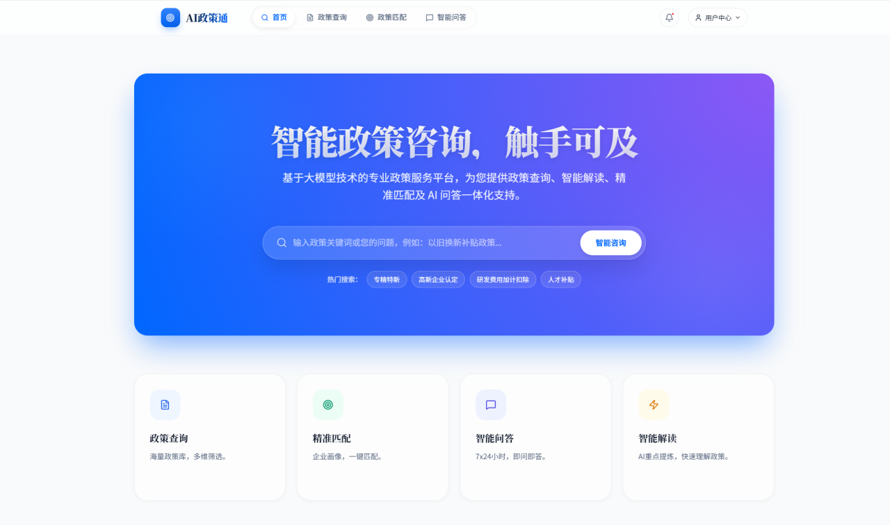

<div align="right">
  English | <a href="./README.md">中文</a>
</div>

<div align="center">
  
  <h1>AI Policy Agent · SDAgent</h1>
  <h3>🏛️ Shandong Provincial Smart Policy Consulting Assistant</h3>
  <p align="center">
    <strong>Policy Interpretation | Subsidy Calculation | Multimodal Recognition | Multi-Agent Management</strong>
  </p>
  <p><em>An end-to-end intelligent knowledge base Q&A system built on RAG + Multi-Agent technology for Shandong provincial policy scenarios.</em></p>

  
  
  
  <a href="https://github.com/Lvyizhuo/MyProject-SDAgent/issues">
    
  </a>
  <a href="https://github.com/Lvyizhuo/MyProject-SDAgent/blob/master/LICENSE">
    
  </a>

  <div align="center" style="margin-top: 15px;">
    
    
    
    
    
  </div>
</div>

---

## 📖 Introduction

**AI Policy Agent** is an LLM-powered consulting system designed for Shandong Province's "Trade-in" (以旧换新) policies. It supports intelligent Q&A, automated subsidy estimation, and multimodal recognition. The system includes a comprehensive Admin Console for multi-agent orchestration, knowledge base management, and model service routing.

## 🏢 Business Scenarios

Designed for government departments, public service platforms, and industry associations. It focuses on high-frequency consulting needs regarding Shandong's trade-in policies, creating a closed-loop service of **"Query + Calculation + Recognition"** to reduce manual workload and improve policy accessibility.

## ✨ Key Features

- **Policy Q&A**: Structured, traceable answers based on RAG (Retrieval-Augmented Generation).
- **Subsidy Calculation**: Automatic calculation of subsidy amounts based on region, category, and price.
- **Multimodal Recognition**: Supports Voice-to-Text (ASR), Image/Device recognition, and Invoice OCR.
- **Multi-Agent Management**: Create and manage multiple independent agent instances (Policy Advisor / Subsidy Calculator / Contract Reviewer / Data Analyst / Voice Receptionist), each with independent model bindings, system prompts, and skill toggles.
- **Model Management**: Unified management of LLM / Vision / Audio / Embedding / Rerank models with connectivity tests and enable/disable toggles.
- **Tool Governance**: Card-based tool display with centralized on/off switches (Web Search / Subsidy Calculator / File Parser / Code Sandbox).
- **Knowledge Base**: Document upload, URL import, chunking preview, archive export/import, and batch operations.
- **Governance & Security**: Features authentication, tool-call intent validation, fallback strategies, and audit logging.

## 🛠️ Tech Stack

| Layer | Technologies |
|------|--------|
| **Frontend** | React 19 + Vite 7, pnpm package manager |
| **Backend** | Spring Boot 3.4.1 + Spring AI 1.0.3 |
| **LLM** | Alibaba DashScope (Default: `qwen3.5-plus`, supports OpenAI-compatible custom models) |
| **Embedding** | Ollama local `bge-m3` (default, 1024-dim) / `nomic-embed-text` (768-dim) |
| **Reranker** | Self-hosted `rerank-service` (Python FastAPI + sentence-transformers, `bge-reranker-v2-m3`), supports TEI / Xinference / DashScope providers |
| **Vector DB** | PostgreSQL 16 + pgvector |
| **Cache/Session** | Redis 7 |
| **Storage** | MinIO (S3 Compatible) |
| **Security** | Spring Security + JWT |

## 📂 Project Structure

```text
├── backend/
│   ├── src/main/java/com/shandong/policyagent/
│   │   ├── advisor/       # Security, Memory, Logging, Re-read Validation
│   │   ├── agent/         # ToolIntentClassifier / AgentPlanParser / ReActPlanningService
│   │   ├── config/        # ChatClient / Security / Embedding / Minio Configs
│   │   ├── controller/    # Chat / Auth / Agent / ModelCard / Tool / Knowledge / PublicConfig APIs
│   │   ├── entity/        # JPA Entities (AgentInstance / AgentModelBinding / ToolDefinition / ModelProvider)
│   │   ├── exception/     # Unified exception handling (BusinessException + GlobalExceptionHandler)
│   │   ├── model/dto/     # Card view and request DTOs
│   │   ├── multimodal/    # ASR and Vision (OCR)
│   │   ├── rag/           # Slicing, Retrieval, Vector Ingestion, Multi-provider Reranking, Dynamic Routing
│   │   ├── repository/    # JPA Repositories (AgentInstance / ToolDefinition)
│   │   ├── service/       # Business logic (Multi-Agent / Model / Tool / Chat orchestration)
│   │   └── tool/          # calculateSubsidy / parseFile / webSearch
│   ├── src/main/resources/
│   │   └── db/migration/  # Flyway migrations (V9: multi-agent tables)
│   ├── docker-compose.yml # PostgreSQL + Redis + MinIO + Ollama + Reranker
│   ├── lombok.config      # Lombok global config
│   ├── maven-settings.xml # Alibaba Cloud Maven mirror
│   └── pom.xml
├── frontend/
│   ├── src/
│   │   ├── components/
│   │   │   ├── ui/        # DeepSeek-style chat UI (ChatPage/ChatWindow/InputArea/Sidebar/MessageBubble)
│   │   │   └── admin/     # Admin Console (TopTabs/AdminSidebar/AgentsTab/KnowledgeTab/ModelsTab/ToolsTab)
│   │   ├── pages/         # HomePage, LoginPage, AdminConsolePage etc.
│   │   ├── services/      # 6 API service layers (api/adminApi/adminAgentApi/adminModelApi/adminToolApi/adminKnowledgeApi)
│   │   └── context/       # AuthContext global auth state
│   ├── nginx.conf         # Nginx config (API proxy + Actuator proxy + static caching)
│   ├── pnpm-lock.yaml     # pnpm lock file
│   └── package.json
├── rerank-service/        # Python FastAPI reranker microservice (TEI-compatible protocol)
│   ├── Dockerfile
│   ├── requirements.txt
│   └── server.py
├── deploy/                # Production deployment (Docker Compose + deploy scripts with subcommand system)
├── data/
├── docs/api/              # Complete REST API documentation (11 files)
└── scripts/
```


## 🚀 Quick Start

### Prerequisites

  - Java 21+
  - Node.js 18+
  - Docker & Docker Compose
  - pnpm (frontend package manager)

### 1\. Environment Variables

```bash
export DASHSCOPE_API_KEY=your_key
export TAVILY_API_KEY=your_key  # Optional for web search
export APP_JWT_SECRET=your_secret
```

### 2\. Infrastructure

```bash
cd backend
docker compose up -d
```

### 3\. Backend & Frontend

```bash
# Backend
./mvnw spring-boot:run

# Frontend
cd frontend
pnpm install && pnpm run dev
```

## 🖥️ Admin Console

The Admin Console provides 4 core modules with top tab navigation and sidebar:

1. **Agents**: Multi-agent instance management (create/edit/duplicate/delete/set default). Each agent can independently bind LLM/VISION/AUDIO/EMBEDDING/RERANK models, configure system prompts, greeting messages, skill toggles, and knowledge base folders.
2. **Knowledge Base**: Folder management, document/URL ingestion, chunking preview, batch operations, and archive export/import.
3. **Tools**: Card-based tool display with centralized on/off switches (Web Search / Subsidy Calculator / File Parser / Code Sandbox) and call statistics.
4. **Model Management**: Maintain LLM, Visual, Audio, Embedding, and Rerank models with connectivity tests, enable/disable toggles, and built-in model auto-merge.

On first startup, the system automatically seeds 5 default agents and 4 default tools.

## 🌐 Server Deployment (BaoTa + Docker Compose)

For production deployment on Linux, use the `deploy/` directory for one-click startup (frontend + backend + PostgreSQL + Redis + MinIO + Ollama + Reranker).

### 1. Prepare deployment config

```bash
cd /www/wwwroot/MyProject-SDAgent
cp deploy/.env.example deploy/.env
vi deploy/.env
```

At minimum, configure:
- `DASHSCOPE_API_KEY`
- `APP_JWT_SECRET`
- `APP_MODEL_PROVIDER_ENCRYPTION_SECRET` (optional but recommended for model provider API key encryption)
- `POSTGRES_PASSWORD`
- `MINIO_PASSWORD`
- `APP_SECURITY_CORS_ALLOWED_ORIGIN_PATTERNS`
- `APP_EMBEDDING_OLLAMA_BASE_URL` (default in container: `http://ollama:11434`)

Generate secrets first:

```bash
openssl rand -base64 48
```

Notes:
- Do not keep placeholder values such as `replace-with-base64-secret` or `replace-with-strong-password`.
- `APP_JWT_SECRET` must be a standard Base64 string, otherwise admin login may fail with `Illegal base64 character`.
- After updating `.env`, recreate at least the `backend` container so new env vars are applied.

### 2. Start containers

```bash
cd /www/wwwroot/MyProject-SDAgent/deploy
./deploy.sh
```

Subcommands available: `./deploy.sh restart|status|logs|down`

### 3. Health checks

```bash
curl -f http://127.0.0.1:8080/actuator/health
curl -f http://127.0.0.1:8080/api/chat/health
curl -f http://127.0.0.1:5173/health
```

### 4. BaoTa reverse proxy setup

Recommended order (example domain: `mmgg.dpdns.org`):

1. Configure DNS
- Add an A record in your DNS provider (for example, Cloudflare): `mmgg.dpdns.org -> your server public IP`.

2. Open required ports
- Open `22/80/443` on security group and firewall.
- Do not expose `8080/5173` publicly because containers are bound to `127.0.0.1`.

3. Create Docker website in BaoTa
- Path: `BaoTa Panel -> Docker -> Website -> Create`.
- Choose: `Reverse Proxy Container` (not `Runtime Environment` or `Create from App`).
- Domain: `mmgg.dpdns.org`.
- Container: `policy-agent-frontend`.
- Port: prefer container port `80` (if only mapped ports are shown, select `5173`).

4. Add backend routes in BaoTa custom config (server block)
- In `Config -> Custom Config File (server block)`, do not wrap with `server {}`.
- If `location /` already exists, do not add another one.

```nginx
location /api/ {
  proxy_pass http://127.0.0.1:8080/api/;
  proxy_http_version 1.1;
  proxy_set_header Connection "";
  proxy_set_header Host $host;
  proxy_set_header X-Real-IP $remote_addr;
  proxy_set_header X-Forwarded-For $proxy_add_x_forwarded_for;
  proxy_set_header X-Forwarded-Proto $scheme;
  proxy_buffering off;
  proxy_cache off;
  proxy_read_timeout 600s;
  proxy_send_timeout 600s;
}

location /actuator/ {
  proxy_pass http://127.0.0.1:8080/actuator/;
  proxy_http_version 1.1;
  proxy_set_header Host $host;
}
```

5. Validate and reload Nginx

```bash
nginx -t && nginx -s reload
```

6. Verify

```bash
curl -f http://mmgg.dpdns.org/health
curl -f http://mmgg.dpdns.org/actuator/health
curl -f http://mmgg.dpdns.org/api/chat/health
```

## 🔄 Production Update

```bash
cd /www/wwwroot/MyProject-SDAgent
git pull
cd deploy
./deploy.sh
```

## 🧰 Troubleshooting

- Backend logs: `docker compose logs -f backend`
- Last backend errors: `docker compose logs --tail=200 backend`
- Container status: `docker compose ps`
- Backend health status: `docker inspect -f '{{.State.Health.Status}}' policy-agent-backend`
- If admin login fails with `Illegal base64 character`, fix `APP_JWT_SECRET` in `.env` (must be standard Base64), then run `docker compose up -d --force-recreate backend`.

## 📌 API Overview

### Chat & Documents

| Method | Path | Description |
|------|------|------|
| POST | `/api/chat` | Standard Q&A |
| POST | `/api/chat/stream` | Streaming Q&A (SSE) |
| GET | `/api/chat/health` | Health check |

### User Auth & Sessions

| Method | Path | Description |
|------|------|------|
| POST | `/api/auth/register` | User registration |
| POST | `/api/auth/login` | User login |
| GET | `/api/auth/me` | Current user info |
| GET | `/api/conversations` | List conversations |
| DELETE | `/api/conversations/{sessionId}` | Delete conversation |

### Multi-Agent Management (New)

| Method | Path | Description |
|------|------|------|
| GET | `/api/admin/agents` | List agents |
| GET | `/api/admin/agents/{id}` | Get agent detail |
| POST | `/api/admin/agents` | Create agent |
| PUT | `/api/admin/agents/{id}` | Update agent |
| DELETE | `/api/admin/agents/{id}` | Delete agent |
| POST | `/api/admin/agents/{id}/default` | Set as default |
| POST | `/api/admin/agents/{id}/duplicate` | Duplicate agent |

### Tool Management (New)

| Method | Path | Description |
|------|------|------|
| GET | `/api/admin/tools` | List tools |
| POST | `/api/admin/tools` | Create tool |
| POST | `/api/admin/tools/{id}/enabled` | Toggle enabled |
| POST | `/api/admin/tools/{id}/test` | Test connectivity |

### Model Management

| Method | Path | Description |
|------|------|------|
| GET | `/api/admin/models` | List models |
| POST | `/api/admin/models` | Create model |
| POST | `/api/admin/models/{id}/test` | Test connection |
| GET | `/api/admin/models-card` | Model card view (new) |

### Multimodal

| Method | Path | Description |
|------|------|------|
| POST | `/api/multimodal/transcribe` | Speech-to-Text |
| POST | `/api/multimodal/analyze-invoice` | OCR Invoice Analysis |

## ⭐ Star History
<a href="https://www.star-history.com/?type=date&repos=Lvyizhuo%2FMyProject-SDAgent">
 <picture>
   <source media="(prefers-color-scheme: dark)" srcset="https://api.star-history.com/chart?repos=Lvyizhuo/MyProject-SDAgent&type=date&theme=dark&legend=top-left&sealed_token=1zmEXmq0cgFKU8Oys5Rt8prCbinHs8BASpIYDGVrJxfixZ5HCMZqaFgy258mNXow06K0KhmlUv57RByt-scMlWhZhyo_ABk7UXvRarKqXsBq10rnqYi1tw" />
   <source media="(prefers-color-scheme: light)" srcset="https://api.star-history.com/chart?repos=Lvyizhuo/MyProject-SDAgent&type=date&legend=top-left&sealed_token=1zmEXmq0cgFKU8Oys5Rt8prCbinHs8BASpIYDGVrJxfixZ5HCMZqaFgy258mNXow06K0KhmlUv57RByt-scMlWhZhyo_ABk7UXvRarKqXsBq10rnqYi1tw" />
   
 </picture>
</a>

> 如果这个项目对你有帮助，欢迎点个 Star⭐；也欢迎提交 Issue 或 PR，一起把山东省政策智能体做得更实用。
